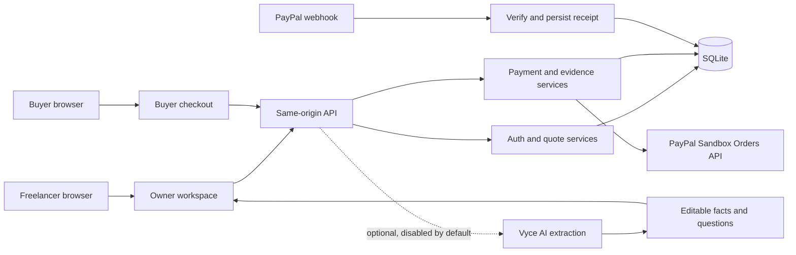

# Scope to Deposit

Scope to Deposit turns a client brief into an editable scope, a human-approved quote, and a buyer checkout link. The local build uses a real sandbox-only payment boundary. PayPal access and AI generation are currently unconfigured, so the app supports manual scope editing and approval and keeps checkout disabled.

This is a local hackathon prototype. It is not a production payment service, contract system, accounting tool, or legal/tax advisor.

## Local setup

Requirements: Node.js `>=24 <26` and npm. The verified runtime was Node.js 25.8.1.

```sh
npm ci
cp .env.example .env.local
npm run setup:owner
npm run dev
```

Open `http://127.0.0.1:3000`. The setup command creates an owner named `owner` unless a different username is supplied. It writes the generated password to `.data/owner-access.json` with private file permissions and does not print the password. Read that file locally. Never commit or share it.

`APP_ORIGIN` and the browser Host must match exactly. Keep the default `http://127.0.0.1:3000`; `localhost` and other aliases are rejected by the authentication boundary. Local database defaults to `.data/scope.sqlite`.

The sample brief is synthetic. AI extraction remains disabled unless authorized model usage and configuration are supplied. No API key is required to use manual editing, quote approval, or local tests.

## Commands

| Command | Purpose |
| --- | --- |
| `npm run dev` | Start the loopback development server |
| `npm run build` | Build the production app |
| `npm run start` | Start the production build on loopback |
| `npm run typecheck` | Run TypeScript checks |
| `npm test` | Run local service and boundary tests |
| `npm run test:e2e` | Run the Playwright suite after installing its browser with `npx playwright install chromium` |
| `npm run setup:owner` | Provision the first local owner and private access file |
| `npm run check:access` | Check sandbox OAuth only when credentials exist; never creates an order or capture |
| `npm run evaluate` | Run the 30-case model evaluation only when authorized AI usage is enabled; otherwise records `NOT RUN` |

## Product flow

1. Freelancer signs in and creates an engagement from a client-approved brief or the synthetic sample.
2. Scope fields and questions stay editable. AI extraction, when authorized and enabled, can return facts and questions only.
3. Freelancer adds USD line items, resolves blocking questions, and explicitly approves the quote. The server stores an immutable revision.
4. With sandbox app credentials and merchant configuration, the freelancer can issue a scoped buyer capability. The buyer reviews the approved quote and continues to PayPal Sandbox.
5. Only server-verified capture evidence can show a paid deposit. Redirects and cancellation observations are not payment evidence.

## Architecture



SQLite and payment operations are local/single-process. The client never supplies authoritative order or amount data. Buyer capability moves from the link fragment into tab `sessionStorage`, then travels only in the same-origin `X-Checkout-Token` header. PayPal return URLs carry no capability.

## Security and operational limits

- PayPal origin is fixed to the sandbox API. Live money, refunds, payouts, and deployment are out of scope.
- Owner sessions use server-issued HttpOnly cookies, a separate CSRF token, strict Host/Origin checks, and owner checks on each request.
- Quotes are USD integer cents with bounded quantities and line counts. Approval freezes a revision.
- An uncertain or pending attempt stays guarded. Reconciliation checks the original provider order; it never invents a replacement charge.
- Capture evidence must match the approved order, configured merchant, deposit amount, and USD currency.
- AI output cannot approve scope, set commercial terms, or trigger payment. Vyce AI usage defaults to `false` through `AI_USAGE_ENABLED`.
- Keep `.env.local`, `.data/`, logs, database files, and private owner credentials out of Git. No private credentials are included in the client bundle.
- The native SQLite API and current Node runtime are tested for this prototype, not claimed as production-ready infrastructure.

Five adapted shadcn/ui primitives are attributed in source and covered by [THIRD_PARTY_NOTICES.md](THIRD_PARTY_NOTICES.md). The entrant source is MIT licensed.

## Verification status

See [RESULTS.md](RESULTS.md) for local evidence and the acceptance ledger. The production browser run passed 23/23 UI and security-boundary checks with zero unexpected console errors. A fresh checkout on Node.js 25.8.1/npm 11.11.0 completed install, owner setup, TypeScript, production build, and health 200 in 33.59 seconds. Genuine PayPal captures, a registered webhook event, model-generation quality, and paid-state screenshots remain unverified. PayPal account access remains missing; three bounded Gemini requests returned HTTP400 with zero validated outputs. See [AI_SMOKE_RESULTS.md](AI_SMOKE_RESULTS.md) and [PAYPAL_SETUP.md](PAYPAL_SETUP.md).
