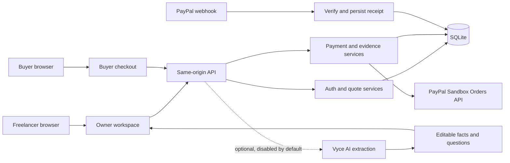

# Scope to Deposit

Scope to Deposit turns a client brief into an editable scope, a human-approved quote, and a buyer checkout link. Three genuine PayPal Sandbox deposits and their authentic completion webhooks are verified. The real AI adapter accepted 22 benchmark drafts, but its strict quality target failed. AI remains disabled by default; current provider access returns HTTP 402 despite positive credit metadata. Manual scope editing and quote approval work independently.

This is a local hackathon prototype. It is not a production payment service, contract system, accounting tool, or legal/tax advisor.

## Local setup

Requirements: Node.js `>=24 <26` and npm. Current Sandbox runtime uses Node.js 24.21.0; the historical fresh-checkout benchmark used Node.js 25.8.1.

```sh
npm ci
cp .env.example .env.local
npm run setup:owner
npm run dev
```

Open `http://127.0.0.1:3000`. The setup command creates an owner named `owner` unless a different username is supplied. It writes the generated password to `.data/owner-access.json` with private file permissions and does not print the password. Read that file locally. Never commit or share it.

`APP_ORIGIN` and the browser Host must match exactly. Keep the default `http://127.0.0.1:3000`; `localhost` and other aliases are rejected by the authentication boundary. Local database defaults to `.data/scope.sqlite`.

The sample brief is synthetic. AI extraction remains disabled unless authorized model usage and configuration are supplied. No API key is required to use manual editing, quote approval, or local tests.

The exact allowed AI models are `deepseek-v4-flash` and `glm-5.3-flash`, configured with `VYCEAI_MODEL`. Vyce displayed GLM as included at $0 per million tokens with a 10-million-token daily allowance on October 16. A dedicated limited test key was provisioned privately. A fresh access recheck returned HTTP 402 in 409 ms, so free judge AI access is not yet established. Published source 1a5247f gives AI fetch and body consumption one 45-second deadline; PayPal deadlines are unchanged. The dedicated key remains private, with no approval to share it. Never enable a paid model or run the stock evaluation script without a separate usage budget and request guard. AI drafts require human review; the latest prompt correction has not passed a fresh live quality evaluation.

## Commands

| Command | Purpose |
| --- | --- |
| `npm run dev` | Start the loopback development server |
| `npm run build` | Build the production app |
| `npm run start` | Start the production build on loopback |
| `npm run typecheck` | Run TypeScript checks |
| `npm test` | Run local service and boundary tests |
| `npm run test:e2e` | Runs Playwright specs under `tests/e2e`; none are currently checked in. Recorded production-browser verification is in [RESULTS.md](RESULTS.md). |
| `npm run setup:owner` | Provision the first local owner and private access file |
| `npm run check:access` | Check sandbox OAuth only when credentials exist; never creates an order or capture |
| `npm run evaluate` | Run the 30-case model evaluation only when authorized AI usage is enabled; otherwise records `NOT RUN` |

## Product flow

1. Freelancer signs in and creates an engagement from a client-approved brief or the synthetic sample.
2. Scope fields and questions stay editable. AI extraction, when authorized and enabled, can return facts and questions only.
3. Freelancer adds USD line items, resolves blocking questions, and explicitly approves the quote. The server stores an immutable revision.
4. With sandbox app credentials and merchant configuration, the freelancer can issue a scoped buyer capability. The buyer reviews the approved quote and continues to PayPal Sandbox.
5. Only server-verified capture evidence can show a paid deposit. Redirects and cancellation observations are not payment evidence.

## Architecture



SQLite and payment operations are local/single-process. The client never supplies authoritative order or amount data. Buyer capability moves from the link fragment into tab `sessionStorage`, then travels only in the same-origin `X-Checkout-Token` header. PayPal return URLs carry no capability.

## Security and operational limits

- PayPal origin is fixed to the sandbox API. Live money, refunds, payouts, and deployment are out of scope.
- Owner sessions use server-issued HttpOnly cookies, a separate CSRF token, strict Host/Origin checks, and owner checks on each request.
- Quotes are USD integer cents with bounded quantities and line counts. Approval freezes a revision.
- An uncertain or pending attempt stays guarded. Reconciliation checks the original provider order; it never invents a replacement charge.
- Capture evidence must match the approved order, configured merchant, deposit amount, and USD currency.
- AI output cannot approve scope, set commercial terms, or trigger payment. Vyce AI usage defaults to `false` through `AI_USAGE_ENABLED`.
- Keep `.env.local`, `.data/`, logs, database files, and private owner credentials out of Git. No private credentials are included in the client bundle.
- The native SQLite API and current Node runtime are tested for this prototype, not claimed as production-ready infrastructure.

Five adapted shadcn/ui primitives are attributed in source and covered by [THIRD_PARTY_NOTICES.md](THIRD_PARTY_NOTICES.md). The entrant source is MIT licensed.

## Verification status

See [RESULTS.md](RESULTS.md) for evidence and the acceptance ledger. On 2026-10-15, all 3/3 genuine Sandbox deposits (USD 1/2/3 against approved USD 10/20/30 quotes) were verified against canonical order, capture, merchant, amount and currency evidence. Three authentic completion webhooks were persisted and processed as paid. Normal buyer returns for the USD 2/3 checkouts visibly showed server-verified payment; the USD 1 paid-state screenshot is retained privately. The temporary webhook listener is not durable judge hosting.

The October 16 local run passed 172/172 service tests, TypeScript and production build. Historical production-browser checks passed 23/23 with zero unexpected console errors; the fresh-checkout setup benchmark completed in 33.59 seconds. The real GLM baseline generated all 20 standard cases and two hostile cases before a timeout stopped the batch. Independent review scored 1/20 strict complete passes and 29/46 labeled ambiguities flagged. The remaining hostile cases and the revised prompt remain unvalidated. Totals: 28 dispatches, 22 schema-accepted outputs and 35,857 reported tokens; two timeouts and two HTTP 402 responses have no usage. Codex IAB currently works with authenticated Vyce. Published source is 1a5247f, including the reviewed 45-second AI deadline. The reviewed 177.00-second video is published UNLISTED at https://youtu.be/tdFlgzJ0MXY; both YouTube checks completed with No issues, and Save confirmed publication at 2:57. The watch page confirms UNLISTED and working playback (177.021-second duration, no player error). Devpost accepted the video embed and saved the story, tags, GitHub URL and video through Save & continue, DRAFT 4/5. Additional information persisted on readback. No final project submission or judge-key sharing has occurred. See [RESULTS.md](RESULTS.md), [AI_SMOKE_RESULTS.md](AI_SMOKE_RESULTS.md) and [PAYPAL_SETUP.md](PAYPAL_SETUP.md).
